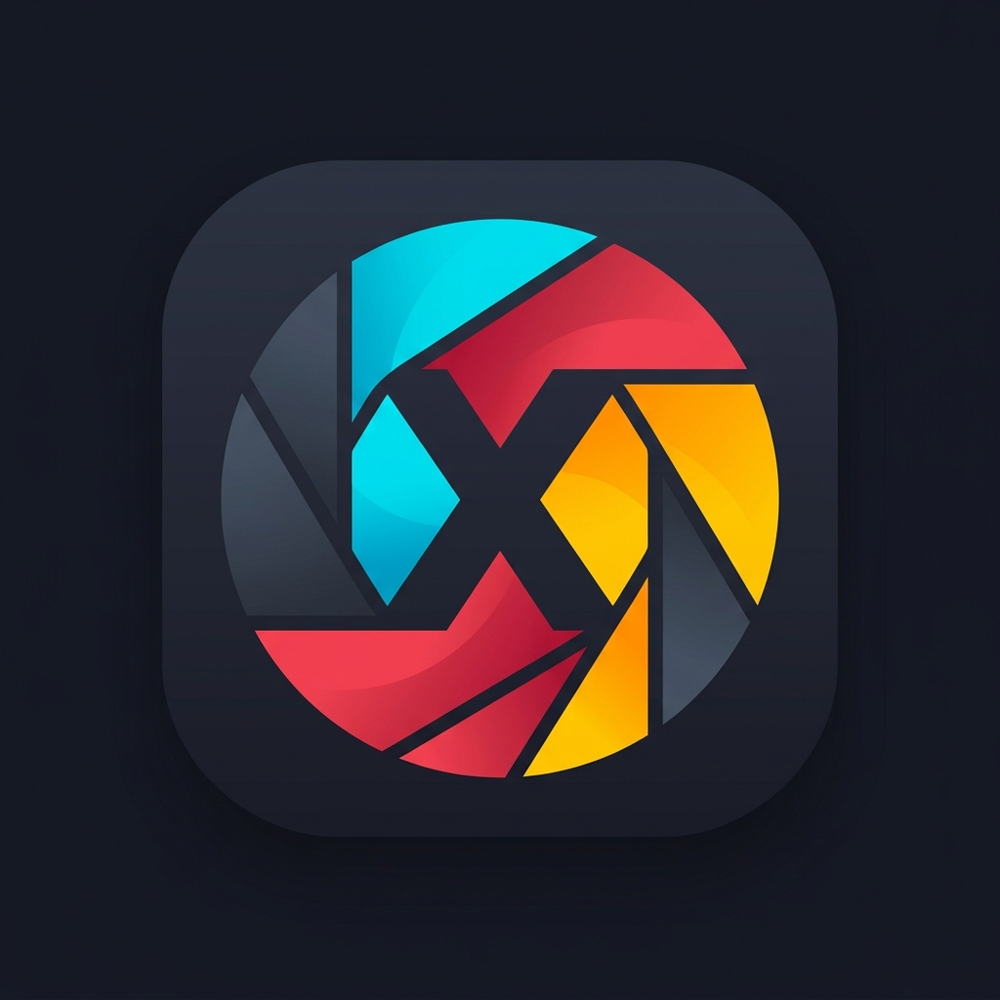

# ApertureX

[](https://www.gnu.org/licenses/gpl-3.0)
[](docs/ROADMAP.md)
[](#)
[](https://prit-007.github.io/ApertureX/)
[](#privacy)

**A mobile-native, non-destructive, free-and-open-source photo editor — the Snapseed/Lightroom replacement the FOSS world never built.**

> *ApertureX* — a photo editor that opens like a camera aperture and edits like a darkroom. It ships **two UIs over one recipe**: a Lightroom-style precision panel UI (default) and a Snapseed-style gesture UI. Internally, every large photo is still edited as a field of **tiles**, never one giant bitmap — the engine's atomic unit.

<p align="center">
  
</p>

> **Status: v0.1.0 (first public pre-release; P1–P2 in progress).** Both UI
> shells (Lightroom panels + Snapseed gestures) and the bulk of the edit
> engine are built: a Rust
> color/spatial/geometry/mask pipeline, a 60fps preview (proxy-resolution + split
> bakes), crop, batch gallery, presets/LUT import, and on-device offline activity
> logs. The **banded full-res export** is now wired end-to-end (single Rust call
> with cancel), and the **high-zoom ROI overlay** (native region decode on
> Android) swaps in a full-res band when zoom crosses the proxy ceiling.
> Several other parts are **built but not yet wired end-to-end** —
> the multi-level tile pyramid for >100 MP and RAW lens corrections —
> each tracked by a
> GitHub issue. See [`docs/IMPLEMENTATION_PLAN.md`](docs/IMPLEMENTATION_PLAN.md)
> for the current status and gaps, [`docs/ROADMAP.md`](docs/ROADMAP.md) for phase
> gates, and the [`docs/PARITY.md`](docs/PARITY.md) ledger.

> **Naming:** the product is **ApertureX** and every identifier is canonical:
> Dart package `aperturex`, applicationId/bundle id `com.devparadise.aperturex`,
> Rust crate `rust_lib_aperturex`. The historical name survives only in git
> history and ADRs.

---

## Privacy

**100% Offline. Zero Cloud Analytics. No AI training on your photos. You own
your data.**

ApertureX has no accounts, no servers, no telemetry and no analytics SDK —
every edit, export and log stays on your device. The claim is *enforced*, not
just written down: [`app/test/core/offline_guard_test.dart`](app/test/core/offline_guard_test.dart)
fails CI if a network or analytics package (`http`, `dio`, `firebase_*`,
`sentry_*`, `supabase`, …) is ever added to `pubspec.yaml`, unless it is
consciously whitelisted with a written justification. The same line is shown
in-app under **Settings → About**.

---

## Why this exists

The mobile photo-editing landscape is a ghost town for free software:

- **Krita** runs on Android but ships a desktop UI that is unusable on a phone.
- **Phimp.me** is abandoned and buggy.
- A fluid, touch-first, **non-destructive** editor with a real color pipeline? It does not exist as FOSS.

Four technical walls explain why nobody has built it. ApertureX is architected to climb all four:

| # | Wall | ApertureX's answer |
|---|------|------------------|
| 1 | RAW decoding is heavy C/C++ (`LibRaw`, `lensfun`) | A Rust core behind `flutter_rust_bridge`, with a pluggable `RawDecoder` |
| 2 | Real-time adjustment needs GPU shaders | A chained GLSL pipeline via Flutter/Impeller fragment shaders |
| 3 | 48–200 MP images blow the OS texture/RAM budget | A **tile-based viewport** with ROI decode + LRU byte budget |
| 4 | FOSS UIs are built for function, not feel | Material 3 + a dedicated Snapseed-style **gesture FSM** |

---

## Architecture at a glance

```
┌─────────────────────────────────────────────────────────────┐
│ UI (Flutter, Material 3)                                     │
│   gesture FSM · tool trays · film strip · histogram          │
├─────────────────────────────────────────────────────────────┤
│ Viewport (Flutter/Impeller)                                  │
│   tile compositor · zoom/pan · fragment-shader chain · cache │
├─────────────────────────────────────────────────────────────┤
│ Edit core (Dart)                                             │
│   non-destructive recipe · undo/redo · presets · sidecars    │
├─────────────────────────────────────────────────────────────┤
│ Engine (Rust via flutter_rust_bridge v2)                     │
│   decode (RAW/JPEG/HEIC) · ROI tiles · demosaic · color ·    │
│   lens correction · full-res export                          │
├─────────────────────────────────────────────────────────────┤
│ Platform glue                                                │
│   scoped storage · camera · share · F-Droid metadata         │
└─────────────────────────────────────────────────────────────┘
```

Full detail: [`docs/ARCHITECTURE.md`](docs/ARCHITECTURE.md).

---

## Documentation map

| Doc | Contents |
|-----|----------|
| [`docs/ARCHITECTURE.md`](docs/ARCHITECTURE.md) | Layers, data flow, tile engine, shader pipeline, dual-UI shells, recipe schema, masking, ML module, memory budget |
| [`docs/ROADMAP.md`](docs/ROADMAP.md) | Phases P-1→P6 + P2.5/P3.5, v0.1 ship gate, exit criteria |
| [`docs/IMPLEMENTATION_PLAN.md`](docs/IMPLEMENTATION_PLAN.md) | Current status audit, file-by-file workstreams, perf tiers, and the issue carrying each remaining task |
| [`docs/PARITY.md`](docs/PARITY.md) | Feature parity matrix (Snapseed/Lightroom × status × phase) |
| [`docs/RISKS.md`](docs/RISKS.md) | The four walls, each risk, and its mitigation |
| [`docs/FORK-STRATEGY.md`](docs/FORK-STRATEGY.md) | How we fork and maintain `pro_image_editor` |
| [`docs/adr/`](docs/adr/) | Architecture Decision Records 0001–0011 |
| [`THIRD_PARTY.md`](THIRD_PARTY.md) | Third-party components, licenses, ML-model ledger, notices |

---

## Building the app

The application lives in [`app/`](app/) (Flutter UI + Rust engine). You need Flutter 3.44.x, the Android SDK (and/or Xcode for iOS), and a Rust toolchain.

```sh
cd app
flutter pub get
flutter run                # on a connected device/emulator
flutter test               # Dart unit tests
(cd rust && cargo test)    # Rust unit tests
flutter build apk          # Android APK (cargokit cross-compiles the Rust crate)
```

The Dart↔Rust bridge is generated by `flutter_rust_bridge_codegen`. After changing `rust/src/api/*`, regenerate the bindings with `flutter_rust_bridge_codegen generate`.

### App icon

The launcher icon is generated from two committed 1024×1024 masters in
[`app/icons/`](app/icons/): `app_icon.png` (the full-colour shutter mark) and
`app_icon_monochrome.png` (a white silhouette for Android 13+ themed icons).
Everything else — Android legacy mipmaps, adaptive-icon layers, and the iOS
`AppIcon.appiconset` — is produced by
[`flutter_launcher_icons`](https://pub.dev/packages/flutter_launcher_icons)
from the config block in [`app/pubspec.yaml`](app/pubspec.yaml). After editing
a master, regenerate and commit the outputs:

```sh
cd app
dart run flutter_launcher_icons
```

## CI & releases

Continuous by design ([`.github/workflows/ci.yml`](.github/workflows/ci.yml),
modelled on [`nook`](https://github.com/prit-007/nook)):

- **Every push/PR** — `flutter analyze` + Dart tests, `cargo fmt/clippy/test`,
  then signed per-ABI + universal release APKs built inside the **F-Droid
  buildserver container** (GitHub artifacts and F-Droid builds share one recipe
  and the same `tool/ci/*` scripts).
- **Tags** — push `vX.Y.Z` (must match `app/pubspec.yaml` and a
  `## [X.Y.Z]` section in [`app/CHANGELOG.md`](app/CHANGELOG.md)) and CI
  publishes a GitHub Release with the APKs and the changelog notes.
- **Signing** — maintainers run [`tool/ci/make_release_keystore.sh`](tool/ci/make_release_keystore.sh)
  once; the keystore stays on their machine (gitignored, back it up) and the
  passwords live as secrets on the `ci` environment. Builds without secrets
  stay unsigned, so fork PRs never break.
- **F-Droid** — the metadata draft is [`docs/fdroid-metadata.yml`](docs/fdroid-metadata.yml);
  submission tracked in [#69](https://github.com/prit-007/ApertureX/issues/69).

---

## Scope

**In scope (v1):** Android + iOS. Non-destructive editing. JPEG/PNG/HEIC import. RAW import (phased). Tile-based viewport for very large images. Material You theming. GPL-3.0, F-Droid-ready.

**Out of scope (v1):** web and desktop targets, cloud sync, accounts, telemetry, AI generative features.

---

## Team — Developer's Paradise

| Name | Role |
|------|------|
| **Prit Vasani** | Builder |
| **Nilay** | AI/ML |
| **Rajvi Adesara** | UX |
| **Vivek Khunt** | Game Dev |
| **Bhargav** | Animation |
| **Meet** | UI |

---

## Contributing

Development is under way. Design review, ADR feedback, and identification of prior art are still welcome, as are bug reports and PRs. The project follows a trunk-`main` + feature-branch workflow with green CI as the bar; see [`docs/ROADMAP.md`](docs/ROADMAP.md) for current phase priorities.

---

## License

GNU General Public License v3.0 — see [`LICENSE`](LICENSE). Third-party components are documented in [`THIRD_PARTY.md`](THIRD_PARTY.md).
